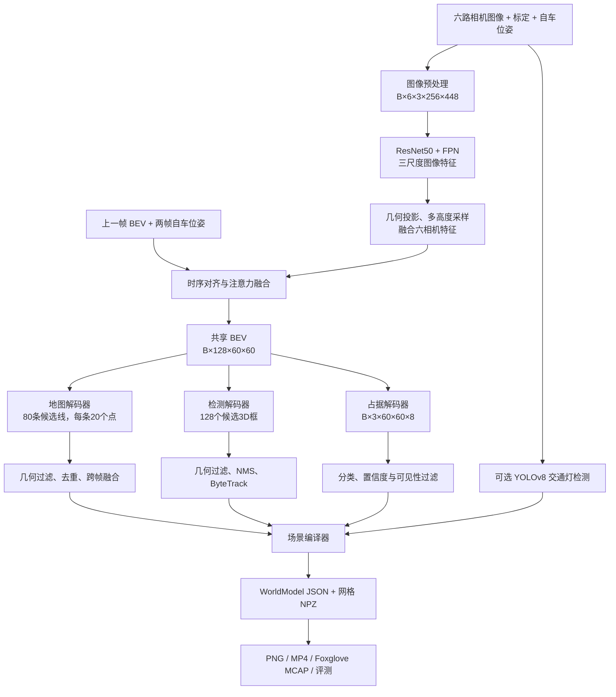
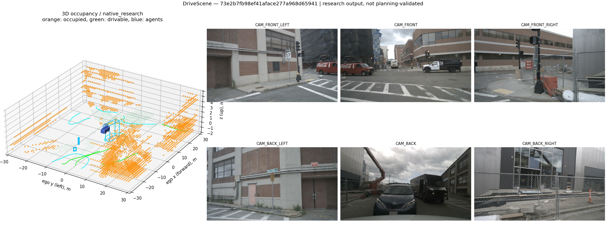

# 自动驾驶场景搭建：DriveScene 完整流程与模型详解

本文依据 DriveScene 当前源码和默认配置整理，说明整体流程、各阶段输入输出、编码与解码方式、模型作用，以及图像、BEV、中间特征和最终产物的尺寸变化。

默认配置来源：[configs/default.yaml](configs/default.yaml)。下文使用 `B` 表示 batch size，当前训练和推理主循环每次处理一帧，单卡通常 `B=1`。张量尺寸根据源码与配置推导，本文整理过程中没有重新执行训练或推理。

## 1. 项目的整体流程

DriveScene 的核心流程是：**把六路环视相机图像编码成一份共享 BEV 特征，再从这份特征中解码出矢量地图、3D 目标和三维占据，经过时序融合、跟踪和场景编译，输出统一的 WorldModel。**

这里的 WorldModel 是按帧组织的结构化场景，包含道路、目标、占据和代价网格；当前代码的主要工作是感知与场景表示。



三个主要任务共享同一份图像特征和 BEV。交通灯检测是可选的独立图像支路。

### 1.1 项目中的四种执行路径

| 路径 | 实际使用什么 | 输出与用途 |
|---|---|---|
| `run --mode annotations` | 地图和目标真值，以及跟踪、编译代码 | 验证数据、坐标与可视化 |
| `run --mode native_research` | 自定义共享 BEV 模型 | 默认的完整感知与编译流程 |
| `scripts/infer_bevformer.py` | 官方配置与权重的 BEVFormer-tiny | 单样本 3D 检测 |
| `scripts/smoke_official_shared.py` | BEVFormer + MapTRv2 + OccFormer 接入结构 | 验证共享特征的前向、反向连通性 |

**默认完整流程中的 BEV 编码器、地图头和占据头，都是项目自己实现的研究版本。** 官方三个模型的接入位于另一份代码中，不能把两套结构和尺寸混在一起。

## 2. 数据准备：图像、标定、位姿与监督标签

源码：[drivescene/data.py](drivescene/data.py)，主要函数为 `prepare_nuscenes()`。

数据准备阶段把 nuScenes 数据整理成逐帧 manifest。每一行 JSON 对应一帧，保存图片路径、标定矩阵、时间戳、场景信息与训练标签。

| 内容 | 形状或形式 | 用途 |
|---|---|---|
| 六路图像 | 六个图片路径 | 神经网络输入 |
| 相机内参 | 每相机 `[3,3]` | 三维点投影到像素 |
| `camera_to_ego` | 每相机 `[4,4]` | 相机坐标转参考车体坐标 |
| `ego_to_image` | 每相机 `[4,4]` | 参考车体坐标投影到图像 |
| `ego_to_global` | `[4,4]` | 时序对齐与全局跟踪 |
| 时间戳、场景 ID | 标量、字符串 | 保证帧顺序与场景隔离 |
| `targets` | 地图、框、占据标签路径 | 训练或真值回放 |

原生模型的相机顺序为：

```text
CAM_FRONT
CAM_FRONT_RIGHT
CAM_BACK_RIGHT
CAM_BACK
CAM_BACK_LEFT
CAM_FRONT_LEFT

即：前 → 右前 → 右后 → 后 → 左后 → 左前
```

统一坐标系与单位为：

```text
x：向前
y：向左
z：向上
位置：米
速度：米/秒
yaw：弧度
```

### 2.1 如何统一六个相机的参考坐标

代码选择**前相机采集时刻的车体坐标系作为参考系**。其他相机通过各自采集时刻的位姿对齐到这个参考系。

令 `T_A←B` 表示从 B 坐标系变换到 A 坐标系，则：

```text
T_参考ego←相机
  = inverse(T_global←参考ego)
    × T_global←相机采集时刻ego
    × T_相机采集时刻ego←相机
```

然后计算投影矩阵：

```text
P_ego→image = K₄×₄ × inverse(T_参考ego←相机)
```

其中 `K₄×₄` 是把相机内参扩展到齐次坐标形式后的矩阵。因此，多相机融合不仅依赖图片，还依赖标定和自车位姿。

manifest 不把六张图片直接编码进 JSON，而是保存路径与矩阵；训练监督单独放在 `targets` 下。

## 3. 图像预处理：变成网络张量并调整投影矩阵

源码：[drivescene/data.py](drivescene/data.py)，函数 `camera_tensor()`。

原图尺寸由 manifest 中的 `height/width` 决定；代码没有硬编码原图必须是某个分辨率。默认统一缩放为：

```text
H = 256
W = 448
```

单张图像的处理过程：

```text
图片文件
→ 解码为 RGB
→ resize 到 448×256（PIL 参数顺序是 W,H）
→ float32 / 255
→ HWC 转 CHW
→ 按通道标准化
```

标准化参数：

```text
mean = [0.485, 0.456, 0.406]
std  = [0.229, 0.224, 0.225]

normalized = (image / 255 - mean) / std
```

完整尺寸变化：

```text
每张图片       [H原, W原, 3]
缩放后         [256, 448, 3]
通道前置       [3, 256, 448]
六相机堆叠     [6, 3, 256, 448]
增加 batch     [B, 6, 3, 256, 448]
```

这里采用直接 resize，没有 letterbox。与此同时，投影矩阵也按像素缩放比例修改：

```text
投影矩阵第0行 × 448 / W原
投影矩阵第1行 × 256 / H原
```

这样三维点投影出来的像素坐标才能匹配缩放后的图片。投影矩阵最终为：

```text
[B, 6, 4, 4]
```

## 4. 图像编码：ResNet50 + FPN

源码：[drivescene/models.py](drivescene/models.py)，类 `ResNet50FPN`。

六个相机共用同一个网络。执行前先合并 batch 与相机维：

```text
[B, 6, 3, 256, 448]
→ [6B, 3, 256, 448]
```

ResNet50 提取 `layer2、layer3、layer4`，FPN 把三层通道统一到 128。

| 阶段 | 输出形状 | 相对输入的空间步长 |
|---|---|---|
| 输入 | `[6B,3,256,448]` | 1 |
| ResNet `conv1` | `[6B,64,128,224]` | 2 |
| maxpool | `[6B,64,64,112]` | 4 |
| `layer1` | `[6B,256,64,112]` | 4 |
| `layer2`，C3 | `[6B,512,32,56]` | 8 |
| `layer3`，C4 | `[6B,1024,16,28]` | 16 |
| `layer4`，C5 | `[6B,2048,8,14]` | 32 |
| FPN 第一尺度 | `[B,6,128,32,56]` | 8 |
| FPN 第二尺度 | `[B,6,128,16,28]` | 16 |
| FPN 第三尺度 | `[B,6,128,8,14]` | 32 |

ResNet50 负责提取图像语义，FPN 负责融合不同空间尺度的信息。FPN 输出后会恢复相机维度。

**这里输出的仍然是各个相机视角下的特征图，还没有变成鸟瞰图。**

权重方面，模型构造时使用 `resnet50(weights=None)`。训练命令显式传入 `--backbone` 时才加载 ResNet50 预训练权重；推理则加载完整的原生模型 checkpoint。

## 5. 空间 BEV 编码：几何投影、多高度采样与特征聚合

源码：[drivescene/models.py](drivescene/models.py)，类 `ProjectedBEVEncoder`。

### 5.1 BEV 的物理范围与分辨率

默认物理范围为：

```text
x ∈ [-30, 30] 米
y ∈ [-30, 30] 米
z ∈ [ -2,  6] 米
```

网格配置：

```text
[X,Y,Z] = [60,60,8]
```

所以最终占据体素的物理分辨率为：

```text
Δx = 1米
Δy = 1米
Δz = 1米
```

BEV 编码阶段先处理水平平面：

```text
60 × 60 = 3600 个 BEV 位置
```

每个位置有一个可学习 query，特征维度为 128：

```text
BEV queries：[3600,128]
```

**BEV 的 `60×60` 来自物理网格配置，不是把图像的 `256×448` 一路下采样得到的。**

### 5.2 在每个 BEV 位置建立四个高度采样点

代码使用：

```text
linspace(-2,6,4)
= [-2, 0.6667, 3.3333, 6]
```

因此采样点总数为：

```text
3600 × 4 = 14400
```

每个点用齐次坐标 `[x,y,z,1]` 表示，所有采样点的张量为：

```text
[3600,4,4]
```

两个 `4` 分别表示“四个高度”和“四维齐次坐标”。这些高度采样位置也不同于最终八层体素的中心高度。

### 5.3 投影到六个相机

对每个三维采样点执行：

```text
projected = P × [x,y,z,1]
u = projected_x / depth
v = projected_y / depth
```

像素坐标张量为：

```text
[B,6,3600,4,2]
```

然后把像素坐标归一化到 `[-1,1]`，用于 `grid_sample`：

```text
u_norm = 2u / 448 - 1
v_norm = 2v / 256 - 1
```

深度为正、且归一化坐标落在有效范围内的采样点才参与聚合。

### 5.4 学习局部采样偏移

每个 BEV query 预测四个二维偏移：

```text
[B,3600,128]
→ Linear(128,8)
→ [B,3600,4,2]
```

通过 `tanh × 0.02` 限制偏移范围，再把偏移加到归一化采样坐标上。

### 5.5 从图像特征中采样并聚合

在三个 FPN 尺度上分别执行采样。每个尺度采样后的特征为：

```text
[B,6,128,3600,4]
```

根据学习得到的高度权重和投影有效性，对相机维、高度维加权聚合；三个尺度的聚合结果再取平均，并与 BEV query 相加。

最终得到：

```text
三尺度相机特征
→ [B,3600,128] BEV tokens
→ [B,128,60,60] BEV feature
```

每个 BEV 单元中保存的是一个 128 维学习特征，供后面的不同任务共同使用。

这里没有先预测一张完整深度图；图像到 BEV 的变换依赖**已知标定、多个候选高度以及可学习采样与特征融合**。

## 6. 时序 BEV 编码：自车运动补偿与注意力融合

时序融合仍然位于 `ProjectedBEVEncoder` 中，历史状态由 [drivescene/pipeline.py](drivescene/pipeline.py) 维护。

额外输入：

```text
previous BEV：[B,128,60,60]
current_to_previous：[B,4,4]
```

两帧间变换：

```text
T_上一帧ego←当前ego
  = inverse(T_global←上一帧ego)
    × T_global←当前ego
```

代码在当前 BEV 的 `z=0` 平面取点，经上述矩阵映射到上一帧，再用 `grid_sample` 读取上一帧特征。

```text
上一帧 BEV
[B,128,60,60]

→ 自车运动补偿

对齐后的上一帧 BEV
[B,128,60,60]
```

对于每个 BEV 位置，构造长度为 2 的记忆：

```text
[当前位置的当前特征, 当前位置的历史特征]
```

注意力的张量尺寸：

```text
Query：[B×3600,1,128]
Key/Value：[B×3600,2,128]
```

执行 8 头注意力，再经过残差、FFN 和 LayerNorm，输出：

```text
[B,128,60,60]
```

这里的时序注意力逐位置融合当前与历史，记忆长度为 2。

推理会保存 `result["bev"].detach()` 供下一帧使用；换场景或时间间隔超过 1.5 秒时清空历史。训练也维护历史，并额外处理时间倒序或重复的情况。`detach` 使梯度不沿着全部历史帧持续回传。

### 6.1 几何可见性掩码

编码器同时输出：

```text
observed：[B,60,60,8]，bool
```

它由四个高度的投影有效性映射到八层体素高度得到。**这个掩码表示几何上落入相机视野，并未进行遮挡判断。**

## 7. 地图解码：实例查询与点查询生成矢量折线

源码：[drivescene/models.py](drivescene/models.py)，类 `VectorMapHead`。

地图有五个类别：

```text
divider               分隔线
centerline            中心线
boundary              边界
pedestrian_crossing   人行横道
stop_line             停止线
```

默认容量：

```text
80 个地图实例
每个实例 20 个点
每个 query 128 维
```

### 7.1 构造地图查询

```text
instance embedding：[80,128]
point embedding：   [20,128]

相加并广播：
[80,20,128]

展平：
[1600,128]
```

第 i 条线的第 j 个点使用：

```text
query(i,j) = instance_embedding(i) + point_embedding(j)
```

### 7.2 压缩 BEV memory 并解码

BEV 先经过平均池化：

```text
[B,128,60,60]
→ [B,128,20,20]
→ [B,400,128]
```

这 400 个 BEV token 作为 Transformer Decoder 的 memory。默认解码器有 2 层、8 个 attention heads，通道为 128，FFN 隐藏维度为 256。

```text
Query：[B,1600,128]
Memory：[B,400,128]

→ Transformer Decoder

[B,1600,128]
→ [B,80,20,128]
```

### 7.3 输出类别与坐标

| 输出 | 操作 | 尺寸 |
|---|---|---|
| 地图类别 | 每条线的 20 点特征取均值，再分类 | `[B,80,6]` |
| 地图坐标 | 每个点的特征回归二维坐标 | `[B,80,20,2]` |

类别维度为 6，因为包含一个 `no-object`。

坐标回归使用：

```text
xy = sigmoid(raw_xy) × [60,60] + [-30,-30]
```

所以输出已经是**车体坐标系中的米制坐标**，不是图像像素，也不是 BEV 整数索引。

每条地图实例包含：

```text
kind：地图类别
score：置信度
points：20 个 [x,y] 点
id：实例标识
```

### 7.4 地图后处理与跨帧融合

源码：[drivescene/map_postprocess.py](drivescene/map_postprocess.py)。

后处理执行分类阈值过滤、折线平滑、长度与转角检查、自交检查，以及同类 Chamfer 距离去重。

跨帧融合流程：

```text
当前 ego 折线
→ 全局坐标
→ 同类折线匹配
→ 点序方向对齐
→ EMA 融合
→ 当前 ego 坐标
→ 再次过滤与去重
```

默认 EMA 为：

```text
融合坐标 = 0.65 × 当前观测 + 0.35 × 历史坐标
```

默认至少命中 2 次才输出，最终最多保留 64 条：

```text
网络候选：[80,20,2]
最终地图：[M,20,2]，默认 M≤64
```

## 8. 目标检测解码：128 个查询预测 3D 框

源码：[drivescene/models.py](drivescene/models.py)，类 `DetectionHead`。

检测类别有 10 类：

```text
car、truck、construction_vehicle、bus、trailer、
barrier、motorcycle、bicycle、pedestrian、traffic_cone
```

### 8.1 查询与解码尺寸

检测头也先把 BEV 池化到 `20×20`：

```text
BEV：[B,128,60,60]
→ [B,128,20,20]
→ Memory：[B,400,128]
```

然后用 128 个可学习 query 解码：

```text
[B,128,128]
→ 2层、8头 Transformer Decoder
→ [B,128,128]
```

输出：

| 输出 | 尺寸 | 含义 |
|---|---|---|
| `logits` | `[B,128,11]` | 10 类目标 + no-object |
| `boxes` | `[B,128,10]` | 每个框的 10 个参数 |

### 8.2 框参数如何编码与解码

10 个参数依次为：

```text
[x,y,z, length,width,height, sin(yaw),cos(yaw), vx,vy]
```

对应变换：

```text
中心：
sigmoid(raw_center) × [60,60,8] + [-30,-30,-2]

长宽高：
softplus(raw_size) + 0.1

角度：
yaw = atan2(sin分量, cos分量)

速度：
直接回归 vx、vy
```

解码后的目标示例：

```json
{
  "kind": "car",
  "score": 0.88,
  "center": [12.3, -3.2, 0.5],
  "size": [4.5, 1.8, 1.6],
  "yaw": 0.12,
  "velocity": [2.1, 0.0]
}
```

该示例仅说明输出格式。

### 8.3 过滤与 NMS

源码：[drivescene/detection_postprocess.py](drivescene/detection_postprocess.py)。

后处理按类别置信度、物理尺寸、速度、空间范围进行过滤，再执行同类目标去重：

```text
中心距离 < 1米
或者
旋转 BEV IoU > 0.25
```

满足其中之一即可视为重复候选。推理 NMS 使用旋转框 IoU。

## 9. ByteTrack：为检测结果建立跨帧 ID

源码：[drivescene/tracking.py](drivescene/tracking.py)，类 `BEVByteTracker`。

ByteTrack 接在检测后处理后面，实际接法为：

```text
ego 坐标中的旋转 3D 框
→ 计算水平面四角
→ 转到全局坐标
→ 求全局 XY 轴对齐外接矩形
→ 按类别交给 Ultralytics ByteTrack
→ 匹配回当前帧的原始 3D 检测
```

因此 ByteTrack 关联的是二维矩形；目标的高度、朝向等仍来自匹配到的 3D 检测。

已有轨迹的速度通过真实时间差重算：

```text
v_global = (p_global当前 - p_global上一观测) / Δt
```

再旋转回当前车体坐标。首次建立轨迹时保留检测头速度；后续已匹配轨迹可使用全局位移计算的速度。

最终数量可变：

```text
128 个候选框
→ 过滤、NMS
→ 跟踪
→ N 个带稳定 ID 的 agents
```

不同场景会重置跟踪状态；同一场景要求时间戳严格递增。

## 10. 占据解码：二维 BEV 扩展为三维体素

源码：[drivescene/models.py](drivescene/models.py)，类 `DualPathOccupancyHead`。

### 10.1 从 BEV 扩展高度维

可学习高度 embedding：

```text
[1,128,1,1,8]
```

与 BEV 相加：

```text
BEV：
[B,128,60,60]

增加高度维：
[B,128,60,60,1]

加高度 embedding：
[B,128,60,60,8]
```

每个 XY 位置的 BEV 特征被扩展到八层高度，并用不同的可学习高度特征区分各层。

### 10.2 局部三维路径与全局平面路径

| 路径 | 运算 | 尺寸变化 |
|---|---|---|
| 局部三维路径 | 两个带残差的 3D 卷积块 | 始终 `[B,128,60,60,8]` |
| 全局平面路径 | BEV 池化、Transformer、插值 | `60×60 → 10×10 → 60×60` |

每个局部卷积块包含：

```text
3×3×3 depthwise Conv3d
→ GroupNorm
→ GELU
→ 1×1×1 Conv3d
```

全局路径为：

```text
[B,128,60,60]
→ 平均池化 [B,128,10,10]
→ 展平 [B,100,128]
→ TransformerEncoderLayer
→ [B,128,10,10]
→ 双线性插值 [B,128,60,60]
→ 广播到高度维
```

### 10.3 逐体素分类

融合后用 `1×1×1 Conv3d` 分类：

```text
[B,128,60,60,8]
→ [B,3,60,60,8]
```

三个类别：

```text
0：free
1：occupied
2：drivable
```

推理解码先对类别维做 softmax、argmax：

```text
[B,3,60,60,8]
→ 单帧 [3,60,60,8]
→ labels [60,60,8]
```

### 10.4 置信度、可见性与几何过滤

源码：[drivescene/pipeline.py](drivescene/pipeline.py)，函数 `decode()` 和 `_filter_occupancy()`。

| 类别 | 默认置信度阈值 |
|---|---:|
| free | 0.60 |
| occupied | 0.97 |
| drivable | 0.85 |

低于阈值、或 `observed=False` 的位置，都改成：

```text
255：unknown
```

**unknown 是后处理赋予的状态，网络分类头只有三个通道。**

随后还会：

- 过滤孤立的 occupied 体素；
- 每个 XY 列最多保留 4 个 occupied 体素，优先保留置信度高的；
- 把体素中心高度不在 `[-2,0.5]` 米内的 drivable 体素改成 unknown。

最终每帧占据输出：

```text
uint8 [60,60,8]
总计 28,800 个体素
```

这条路径始终保持 `60×60` 的主 XY 网格；`10×10` 只用于占据头内部的全局注意力分支。

## 11. 交通灯：独立 YOLOv8 图像支路

源码：[drivescene/lights.py](drivescene/lights.py)，类 `YOLOv8Lights`。

只有传入 `--lights` 才启用：

```text
六个原始图片路径
→ Ultralytics YOLO.predict(...)
→ 每相机若干二维检测框
```

它不读取共享 BEV。默认 checkpoint 配置为 `checkpoints/yolov8n.pt`。

项目没有在该 `predict()` 调用中显式指定 `imgsz`，所以 YOLO 实际网络输入大小取决于 Ultralytics 和模型配置，不能写成主分支的 `256×448`。

输出字段：

```text
bbox_xyxy：[xmin,ymin,xmax,ymax]，原图像素坐标
state：red / yellow / green / off / unknown
position_ego：None
camera：来源相机
score：检测置信度
```

默认通用权重识别到 `traffic light` 时，代码赋予 `state="unknown"`。提供按红黄绿等类别训练过的模型，才会通过类别名称映射状态。

当前支路没有实现交通灯三维定位，因此不会自动产生可用的车体坐标位置。编译器只有在灯具提供 `position_ego` 时，才能尝试与停止线进行几何关联；这种关联仍是几何候选关系。

## 12. 场景编译：统一成 WorldModel

源码：[drivescene/compiler.py](drivescene/compiler.py)，函数 `compile_scene()` 与 `save_world()`。

输入为：

```text
map_vectors：M 条折线
agents：N 个带跟踪 ID 的目标
traffic_lights：L 个灯具结果
semantic：[60,60,8]
ego pose、时间戳、来源信息
```

### 12.1 把目标框栅格化

生成：

```text
agent_mask：[60,60,8]，bool
```

判断每个体素中心是否落在目标的旋转 3D 框内，并在各方向增加默认 `0.3m` 的 margin。

### 12.2 分离目标覆盖的占据

```text
occupied = semantic == 1
static_occupied = occupied AND NOT agent_mask
```

代码保留原始 `semantic`，另外生成 `static_occupied`，不会直接删除原始语义网格中的目标体素。

`agents` 中也可能包含 barrier、traffic_cone 等类别，因此这里是按检测框覆盖关系分离，并不等价于严格判断物体是否正在运动。

### 12.3 生成二维代价网格

```text
cost：[60,60]，float32
```

只考察体素中心高度位于 `[-1,2]` 米的部分：

```text
存在静态占据或目标框覆盖 → cost=1.0
否则，只要存在 unknown  → cost=0.7
其余情况               → cost=0.0
```

### 12.4 输出文件与序列化方式

| 文件或字段 | 内容 | 默认形状 |
|---|---|---|
| `<token>.json` | 地图、目标、交通灯、坐标系、来源、网格描述 | 结构化数据 |
| NPZ `semantic` | 占据类别 | `[60,60,8]` |
| NPZ `static_occupied` | 目标框之外的占据掩码 | `[60,60,8]` |
| NPZ `agent_mask` | 目标框覆盖掩码 | `[60,60,8]` |
| NPZ `cost` | 地面导航代价 | `[60,60]` |

JSON 主要字段为：

```text
layers.vector_map
layers.agents
layers.traffic_lights
occupancy.grid
occupancy.artifact
provenance
ego_to_global
```

保存时使用 `np.savez_compressed` 压缩网格，JSON 引用对应 NPZ。读取时使用 `json.loads` 和 `np.load`，恢复后的网格形状不变。

输出中包含 `validated_for_planning=False`，表示当前编译结果属于研究输出。

### 12.5 真值回放模式的占据处理

当前 `annotations` 模式只读取地图和目标真值，**没有把 manifest 中的占据标签传给编译器**。因此这一路的语义占据会保持 unknown，但仍会生成目标框掩码和相应代价。

## 13. 默认流程所有主要尺寸汇总

| 阶段 | 输出尺寸 | 各维含义 |
|---|---|---|
| 六相机输入 | `[B,6,3,256,448]` | 批次、相机、RGB、高、宽 |
| FPN 高分辨率特征 | `[B,6,128,32,56]` | 图像空间 |
| FPN 中分辨率特征 | `[B,6,128,16,28]` | 图像空间 |
| FPN 低分辨率特征 | `[B,6,128,8,14]` | 图像空间 |
| BEV 查询序列 | `[B,3600,128]` | 3600 个水平网格位置 |
| 共享 BEV | `[B,128,60,60]` | 特征、X、Y |
| 几何可见性掩码 | `[B,60,60,8]` | X、Y、Z |
| 地图/检测 memory | `[B,400,128]` | 池化后的 20×20 BEV |
| 地图解码特征 | `[B,80,20,128]` | 实例、点、特征 |
| 地图类别 | `[B,80,6]` | 5 类 + 空类 |
| 地图点坐标 | `[B,80,20,2]` | 米制 x、y |
| 检测解码特征 | `[B,128,128]` | 目标 query、特征 |
| 检测类别 | `[B,128,11]` | 10 类 + 空类 |
| 检测框 | `[B,128,10]` | 中心、尺寸、方向、速度 |
| 三维占据特征 | `[B,128,60,60,8]` | 特征、X、Y、Z |
| 占据 logits | `[B,3,60,60,8]` | 三种语义类别 |
| 单帧语义网格 | `[60,60,8]` | uint8 标签 |
| 单帧代价网格 | `[60,60]` | float32 代价 |

其中的几个 `128` 含义不同：**BEV 通道数 128 和检测查询数 128 只是配置中恰好相同。**

## 14. 训练监督、标签编码与损失

训练入口：[drivescene/pipeline.py](drivescene/pipeline.py) 中的 `train()`。

损失实现：[drivescene/models.py](drivescene/models.py) 中的 `supervised_loss()`。

地图、框和占据分别使用自己的标签编码与损失，梯度共同更新共享编码器。

### 14.1 地图监督

```text
nuScenes 全局地图
→ 裁剪当前车辆周围范围
→ 转换到参考 ego 坐标
→ 再严格裁剪到 [-30,30]²
→ 每条折线按弧长均匀采样 20 点
```

每帧标签：

```text
[M_gt,20,2] + M_gt 个类别
```

训练通过 Hungarian matching，把 80 个预测实例与真值实例匹配。折线正序、反序都计算匹配成本，选择较小者。

地图损失包括：

```text
分类
点坐标
相邻线段方向
二阶差分/曲率
端点连接关系
重复实例惩罚
```

这里的拓扑损失约束端点距离关系；当前地图头没有单独输出道路拓扑邻接矩阵。

### 14.2 检测监督

检测标签转换为：

```text
[N_gt,10]
= [中心xyz, 长宽高, sin(yaw), cos(yaw), vx,vy]
```

nuScenes 原始尺寸的宽、长顺序会转换成项目采用的长、宽顺序。标签还会过滤没有传感器点支撑的框，以及中心超出网格范围的框。

检测训练同样使用 Hungarian matching，损失包括：

```text
Focal 分类
归一化中心坐标
log 尺寸
方向
有效速度
BEV IoU
```

**训练使用轴对齐 BEV IoU 损失，推理 NMS 使用旋转框 IoU。**

### 14.3 稀疏占据监督

源码：[drivescene/occupancy.py](drivescene/occupancy.py)，函数 `prepare_sparse()`。

离线制作过程：

```text
LiDAR 点 + LiDARseg 类别
→ 转到参考 ego
→ 体素化
→ 沿激光射线标记 free
→ 回波端点标记 occupied 或 drivable
→ 未观测位置保持 unknown
```

体素索引公式：

```text
index = floor((xyz - minimum) / resolution)
```

默认 `resolution=[1,1,1]` 米。标签尺寸为 `[60,60,8]`，类别为 `0、1、2、255`。

射线经过的位置先标 free，端点再覆盖为表面类别；一个体素同时包含道路和物体回波时，occupied 优先。

训练使用：

```text
CrossEntropy(ignore_index=255)
class_weights=[0.2,1.0,1.0]
```

**LiDAR 在这里负责制作监督标签；原生相机推理不读取 LiDAR 点云。** 这份监督是稀疏射线监督，未观测体素没有稠密真值。

### 14.4 联合优化与历史状态

```text
六相机 + 标定 + 历史 BEV
→ 共享模型
→ 三任务预测
→ 各任务损失
→ 求和
→ backward
→ AdamW 更新
```

默认学习率 `5e-5`，weight decay `0.01`，梯度裁剪上限为 5。

单卡一次一帧、六个相机；多卡 DDP 每张卡处理独立帧并同步梯度。完整场景分配给各卡，避免历史 BEV 在不同 worker 之间断开。

缺失的监督任务不会被当成伪负样本训练。checkpoint 会记录 `trained_tasks`，推理解码只输出其中记录的任务；这个字段表示参与过监督训练，不代表精度已经验证。

原生训练入口没有交通灯状态训练分支。

## 15. 官方 BEVFormer、MapTRv2、OccFormer 的共享接入

源码：[drivescene/official_shared.py](drivescene/official_shared.py)，类 `OfficialSharedStack`。

**官方接入是另一套结构，不能直接套用原生模型的 `128×60×60` 尺寸。**

它读取三份上游配置：

```text
BEVFormer：bevformer_tiny.py
MapTRv2：maptrv2_nusc_r50_24ep.py
OccFormer：occformer_nusc_r50_256x704.py
```

整理本文时，这份本地项目没有 `third_party` 目录，因此这些外部配置决定的层数、类别数、完整 BEV 尺寸无法从本地确认。以下区分代码中已经确定的部分与外部配置决定的部分。

| 模型或模块 | 在官方共享结构中的作用 |
|---|---|
| BEVFormer 图像 backbone/FPN | 提取六相机特征 |
| BEVFormer encoder | 生成共享 BEV |
| BEVFormer 检测头 | 输出 3D 检测 |
| MapTRv2 地图头 | 从共享 BEV 解码矢量地图 |
| 自定义 `height_lift` | 把 BEV 扩展为体素特征 |
| OccFormer backbone/neck/head | 三维特征处理及占据输出 |

### 15.1 BEVFormer 提供共享 BEV

```python
features = detector.extract_img_feat(...)
detection = detector.pts_bbox_head(features, ...)
shared = detection["bev_embed"]
```

共享特征格式为：

```text
[H_bev×W_bev, B, 256]
```

重排后：

```text
[B,256,H_bev,W_bev]
```

### 15.2 MapTRv2 如何复用 BEV

代码替换 MapTRv2 的 BEV 特征获取函数，使其从传入的 `prev_bev` 参数直接取共享特征。该参数在这里承担特征传递接口。

先根据 MapTRv2 的空间范围，对 BEVFormer 特征做几何裁剪、采样：

```text
[B,256,H_bev,W_bev]
→ [B,256,H_map,W_map]
→ [B,H_map×W_map,256]
→ MapTRv2 head
```

因此，MapTRv2 原来的图像到 BEV 编码部分在这个接法中被替换，辅助图像与深度监督也关闭了。

### 15.3 OccFormer 如何读取共享 BEV

普通模式的桥接尺寸由代码固定为：

```text
occ_shape=[128,128,16]
```

具体变化：

```text
共享 BEV
[B,256,H_bev,W_bev]

→ 双线性插值
[B,256,128,128]

→ Conv2d(256,128×16,1)
[B,2048,128,128]

→ reshape
[B,128,16,128,128]

→ 调整轴顺序
[B,128,128,128,16]
     C   X   Y   Z

→ OccFormer backbone
→ OccFormer neck
→ OccFormer head
```

BEVFormer 的平面特征采用 `[Y,X]` 顺序，桥接到 OccFormer 时明确换成 `[X,Y,Z]`。

上面的三维张量是 **OccFormer 输入特征**，不能直接把它写成最终占据类别网格的尺寸。后续输出分辨率、类别维度由外部 OccFormer 配置及实现决定。

### 15.4 smoke 模式的尺寸

源码：[scripts/smoke_official_shared.py](scripts/smoke_official_shared.py)。

| 项目 | smoke 设置 |
|---|---|
| BEVFormer BEV | `12×12` |
| BEV tokens | `[144,B,256]` |
| 检测 query | 12 |
| MapTRv2 BEV | `12×12` |
| 地图 one-to-one / one-to-many query | 各 4 |
| 每条地图线点数 | 5 |
| OccFormer 桥接体积 | `[B,128,16,16,8]` |
| OccFormer query | 8 |

传入真实 manifest 时，smoke 图片输入为：

```text
[1,6,3,128,224]
```

没有 manifest 时使用随机张量：

```text
[1,6,3,64,96]
```

该脚本验证图像 backbone 和 BEV encoder 各调用一次，并检查多个分支的梯度。**它没有执行正式的联合监督训练，也没有把官方共享输出接入默认 `run → decode → compile_scene` 全流程。**

新增高度桥接层以及替换后的共享特征关系需要联合训练；单独加载各官方模块权重不能证明整套共享结构已经训练完成。

## 16. 独立官方 BEVFormer 检测脚本

源码：[scripts/infer_bevformer.py](scripts/infer_bevformer.py)。

这是独立的官方检测脚本，图像尺寸为：

```text
原图
→ resize：[6,3,450,800]
→ 底部 pad 30行：[6,3,480,800]
→ batch：[1,6,3,480,800]
```

脚本会调整相机顺序，调用项目的 `camera_tensor()` 做预处理，再构造官方模型需要的 metadata。

投影矩阵通过 `ego_to_image × lidar_to_ego` 转成所需的 `lidar2img`。其流程为：

```text
严格加载检测 checkpoint
→ 提取图像特征
→ BEVFormer 检测头
→ get_bboxes() 解码
→ 框中心、方向、速度转换到 ego 坐标
→ 保留 score≥0.25 的结果
```

当前脚本只处理 manifest 的第一个样本，保存 `frame.json` 和 `report.json`。它没有输出完整的地图、占据和交通灯状态。

## 17. 可视化图片、MP4 与 MCAP 编解码

图片、视频和 MCAP 是对结构化输出的展示或封装，不会改变模型的 BEV 网格。

### 17.1 已有输出示例



左侧由占据、地图和目标框绘制，右侧是六路相机原图。渲染时重新读取原始图片，因此展示图像的清晰度不等同于网络实际使用的 `256×448` 输入。

### 17.2 PNG 尺寸

源码：[drivescene/visualize.py](drivescene/visualize.py)，函数 `render_world()`。

```text
figsize=(20,8)
dpi=120

输出 PNG：
宽 2400 × 高 960
```

默认布局是左侧 BEV/三维场景，右侧六相机 2×3 图片墙。

两个尺寸概念需要区分：

```text
60×60：物理空间中的网格数量
2400×960：包含图表、相机画面、标题的展示图片像素
```

### 17.3 MP4 编码

源码：[drivescene/video.py](drivescene/video.py)。

```text
按时间读取每帧 JSON 和 NPZ
→ 读取原始相机图像
→ render_world() 渲染画布
→ H.264 编码
→ MP4
```

使用 `libx264`，默认 2 FPS，常规渲染画布为 `2400×960`。视频时长由帧数与指定 FPS 决定。

### 17.4 Foxglove MCAP 编码

源码：[drivescene/mcap_export.py](drivescene/mcap_export.py)。

| 内容 | MCAP 中的表示 | 尺寸或数量 |
|---|---|---|
| 六路相机 | 原始 JPEG 字节 | 保持原图分辨率 |
| 相机标定 | 内参、尺寸、变换 | 每相机一份 |
| 地图 | 折线场景元素 | 可变数量 |
| agents | 三维框场景元素 | 可变数量 |
| 占据 | occupied/drivable 体素中心点云 | `N_occ` 个点 |
| 坐标变换 | `/tf` | 相机与 `base_link` 关系 |

每个占据点编码为：

```text
x,y,z：3×float32 = 12字节
r,g,b,a：4×uint8 = 4字节
合计：16字节/点
```

Foxglove 显示的占据点云来自 `60×60×8` 语义网格中被选中的体素中心。MCAP 导出这里选择 occupied 和 drivable，不导出 free/unknown 点；它也不保存共享 BEV 的 128 维神经网络特征。

相机 JPEG 由查看器解码显示，场景与点云按 Foxglove 的消息结构解析。查看三维场景时，项目配置的固定坐标系为 `base_link`。

## 18. 源码阅读入口

| 文件 | 主要职责 |
|---|---|
| [configs/default.yaml](configs/default.yaml) | 默认尺寸、类别、阈值与训练参数 |
| [drivescene/cli.py](drivescene/cli.py) | 命令入口与参数分发 |
| [drivescene/data.py](drivescene/data.py) | manifest、地图标签、图像预处理与投影 |
| [drivescene/geometry.py](drivescene/geometry.py) | 坐标变换、网格中心与几何工具 |
| [drivescene/models.py](drivescene/models.py) | 原生共享模型、三个任务头与损失 |
| [drivescene/pipeline.py](drivescene/pipeline.py) | 训练、推理、解码与时序状态管理 |
| [drivescene/map_postprocess.py](drivescene/map_postprocess.py) | 地图几何过滤与时序融合 |
| [drivescene/detection_postprocess.py](drivescene/detection_postprocess.py) | 检测框过滤与去重 |
| [drivescene/tracking.py](drivescene/tracking.py) | ByteTrack 接入与速度计算 |
| [drivescene/occupancy.py](drivescene/occupancy.py) | LiDARseg 射线占据监督制作 |
| [drivescene/lights.py](drivescene/lights.py) | 可选 YOLOv8 交通灯检测 |
| [drivescene/compiler.py](drivescene/compiler.py) | WorldModel 编译与 JSON/NPZ 保存 |
| [drivescene/official_shared.py](drivescene/official_shared.py) | 官方三模型共享特征接入 |
| [drivescene/visualize.py](drivescene/visualize.py) | PNG 场景渲染 |
| [drivescene/video.py](drivescene/video.py) | MP4 导出 |
| [drivescene/mcap_export.py](drivescene/mcap_export.py) | Foxglove MCAP 导出 |
| [drivescene/evaluate.py](drivescene/evaluate.py) | 地图、检测、跟踪与稀疏占据评测 |
